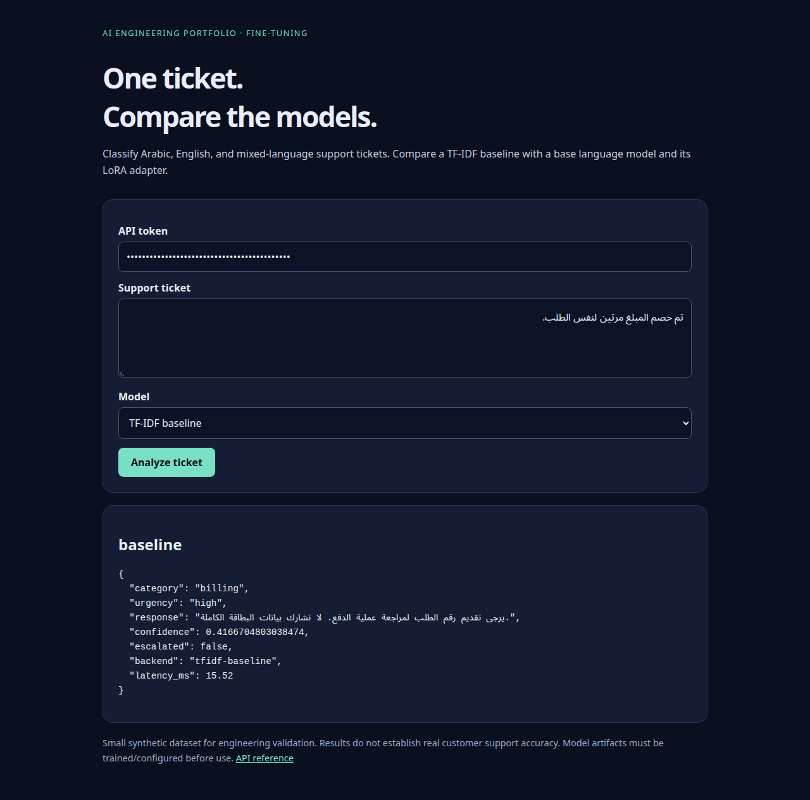

# Arabic–English Support LoRA

**A reproducible fine-tuning pipeline for bilingual support classification and response drafting.**





Train a TF-IDF baseline, fine-tune a small instruction model with LoRA or QLoRA, and compare
the original and adapted models on held-out Arabic, English, and mixed-language tickets.
The browser UI can compare all three models side by side.

## What this demonstrates

- Original synthetic data, explicit split validation, dataset hashes, seeds, and model revision recording.
- Response-only supervised fine-tuning: prompt tokens are masked from the loss, and incomplete targets are rejected.
- LoRA on CPU/CUDA, optional NF4 QLoRA, saved adapters, and base/adapter comparison using the same underlying weights.
- Classification macro-F1, valid-output rate, abstention coverage, latency, and validation token NLL.
- A validation-selected baseline confidence threshold; test data is reserved for final measurement.
- Authenticated inference, Arabic-aware UI, and tests including a real tiny-model adapter update/save/reload.

## Quick demo without a GPU

Python 3.11 or 3.12:

```bash
python -m venv .venv
source .venv/bin/activate
pip install -e '.[dev]'
python -m support_lora.baseline
python -m support_lora.evaluate --output reports/baseline.json
cp .env.example .env
```

Replace the example tokens with random values generated by
`python -c 'import secrets; print(secrets.token_urlsafe(32))'`.

```bash
uvicorn support_lora.api:create_app --factory --env-file .env --host 127.0.0.1 --port 8002
```

Open <http://127.0.0.1:8002> and paste your customer token. Select “TF-IDF baseline.”
The baseline classifies category/urgency and selects a policy response template; it is not a
fine-tuned language model. Missing artifacts return `503`, rather than fabricated predictions.

## Fine-tune with LoRA

The default model is [Qwen/Qwen2.5-0.5B-Instruct](https://huggingface.co/Qwen/Qwen2.5-0.5B-Instruct).
Model downloads need an internet connection and approximately 1 GB of disk space for weights.
CPU training and generative evaluation can take several minutes; reduce the step count
for a pipeline smoke run. `--limit 4` on the evaluation command provides a smaller check.

```bash
# Optional: install the CPU torch build first to avoid CUDA packages on a CPU machine.
pip install torch --index-url https://download.pytorch.org/whl/cpu
pip install -e '.[train]'
python -m support_lora.train --max-steps 40 --max-length 512 --grad-accum 4
python -m support_lora.evaluate --kind causal --output reports/causal.json
```

For a first smoke run use `--max-steps 2 --grad-accum 1`. The trainer writes adapter weights,
tokenizer files, and `training_report.json` to `artifacts/lora/`. Nothing is uploaded to a model hub.
Use `--revision <commit-sha>` for repeatable training against a fixed upstream model revision.

### QLoRA on a CUDA GPU

```bash
pip install -e '.[train,qlora]'
python -m support_lora.train --qlora --max-steps 100 --grad-accum 4
```

QLoRA uses NF4 4-bit base weights, double quantization, and trainable rank-8 adapters on
query/value attention projections. It fails explicitly if CUDA is unavailable.
See the [official PEFT quantization guide](https://huggingface.co/docs/peft/developer_guides/quantization).
The [Colab notebook](notebooks/train_colab.ipynb) provides an optional GPU workflow.

## Compare original and fine-tuned models in the browser

After training, add these lines to `.env` and restart:

```dotenv
MODEL_ID=Qwen/Qwen2.5-0.5B-Instruct
ADAPTER_PATH=artifacts/lora
```

The service loads the model once at startup. Generation is serialized to avoid concurrent
GPU memory pressure. The “original” variant disables the adapter on the same base weights.
Model output must satisfy the category/urgency/response JSON schema; invalid output is
reported as invalid and escalated. There are no model confidence claims for generated text.

## Dataset and evaluation

The bundled fixture contains **32 training, 16 validation, and 24 test records** with four
categories and two urgency levels. English/Arabic occur in every split; mixed-language
examples occur in the test set to expose a distribution shift. The examples were authored
for this project and contain no real customer data. Recreate them with `python scripts/create_fixture.py`.

This is deliberately a small engineering fixture, not enough data to establish useful
support quality. Add consented, reviewed examples with scenario/customer grouping and
near-duplicate checks before making real accuracy claims. Exact normalized duplicate
checks are included; they do not rule out all semantic leakage.

[Recorded results](docs/VALIDATION.md) distinguish actual CPU LoRA runs from untested GPU
QLoRA. [The model card](MODEL_CARD.md) documents intended use and limits.
[Human response review](docs/RESPONSE_REVIEW.md) covers correctness, policy compliance,
and language quality; classification scores alone do not measure these properties.

## Tests and container

```bash
ruff check .
ruff format --check .
pytest --cov=src --cov-report=term-missing
```

`tests/test_training.py` skips when training dependencies are absent. With `.[train]`
installed, it tests actual adapter weight changes and save/reload parity without downloading
a model. A manual GitHub Actions training smoke workflow also exercises this test.

```bash
docker build -t support-lora .
docker volume create support-lora-artifacts
docker run --rm -v support-lora-artifacts:/app/artifacts support-lora python -m support_lora.baseline
docker run --rm -p 127.0.0.1:8002:8000 --env-file .env -v support-lora-artifacts:/app/artifacts support-lora
```

The default image serves the lightweight baseline. GPU model serving needs an image with
training dependencies and CUDA runtime integration; that path is not included in the default image.

## CV wording

“Built an Arabic–English support fine-tuning pipeline with response-only LoRA/QLoRA,
reproducible data splits, a TF-IDF baseline, and base-versus-adapter evaluation.”
Only claim training or score improvements supported by your actual run reports. A pipeline
smoke run is not proof of production accuracy.

MIT licensed project code/data. Upstream model weights retain their own license.
See [security](SECURITY.md), [architecture](docs/ARCHITECTURE.md), and [contributing](CONTRIBUTING.md).

## Browser validation

```bash
pip install -e '.[browser]'
playwright install chromium
python scripts/browser_smoke.py
```

This starts a disposable local server, exercises the UI, checks the 390 px mobile layout,
and saves screenshots. A matching browser check runs in GitHub Actions.

Validate the container with disposable volumes and accounts:

```bash
docker build -t arabic-support-lora:portfolio .
python scripts/container_smoke.py
```

## Download the recorded CPU smoke adapter

The [v0.1.0 release](https://github.com/MSaiedd/arabic-support-lora/releases/tag/v0.1.0)
contains the actual pretrained-Qwen LoRA adapter, tokenizer, run report, and base model license.
Unzip `arabic-support-lora-cpu-smoke.zip` into `artifacts/lora/`, install `.[train]`, and configure
`MODEL_ID` / `ADAPTER_PATH` as shown above. Base model weights are downloaded separately.
The archive SHA-256 is recorded in `reports/adapter-artifact.json`.

This adapter received eight CPU optimizer steps on synthetic examples. It is a reproducible
engineering smoke artifact, not a fully trained or validated customer support model.

Recorded held-out fixture results: base category macro-F1 **0.3889**, eight-step LoRA
**0.4554**, TF-IDF **0.7542**. Base/LoRA valid JSON: **75% / 95.8%**.
The baseline remains stronger at classification on this fixture. Full predictions and
limitations are in `reports/causal.json` and `docs/VALIDATION.md`.
